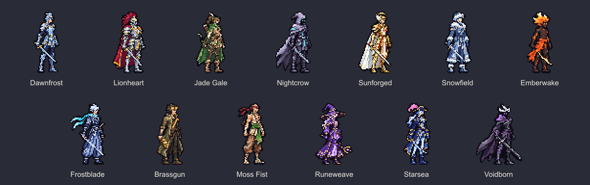
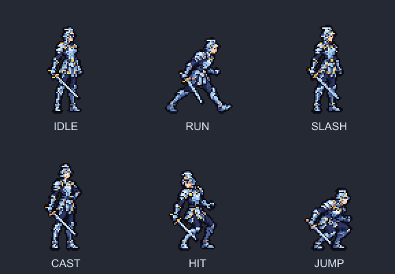
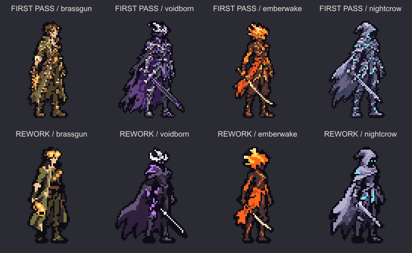
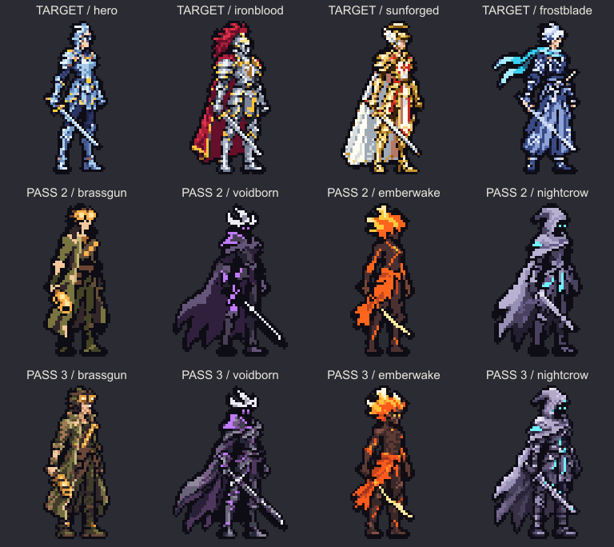
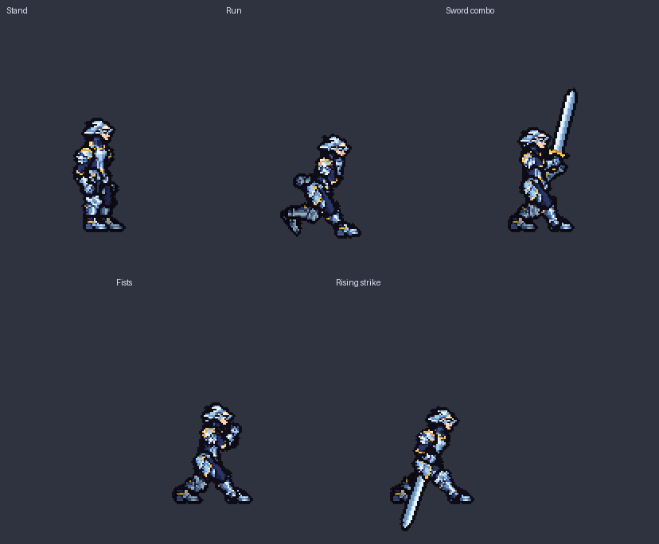
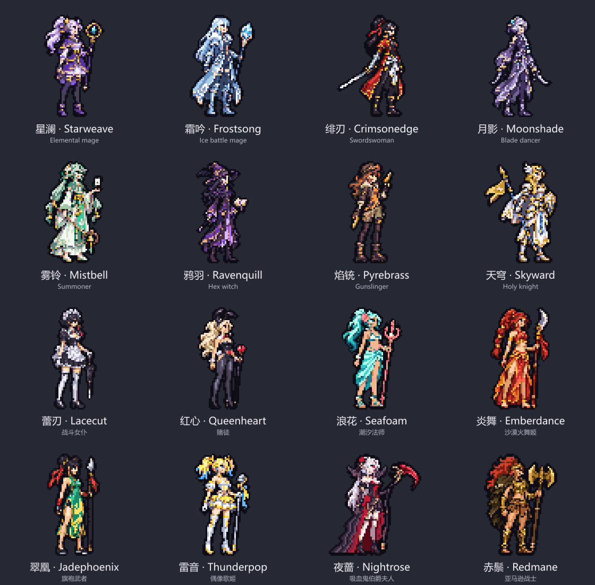
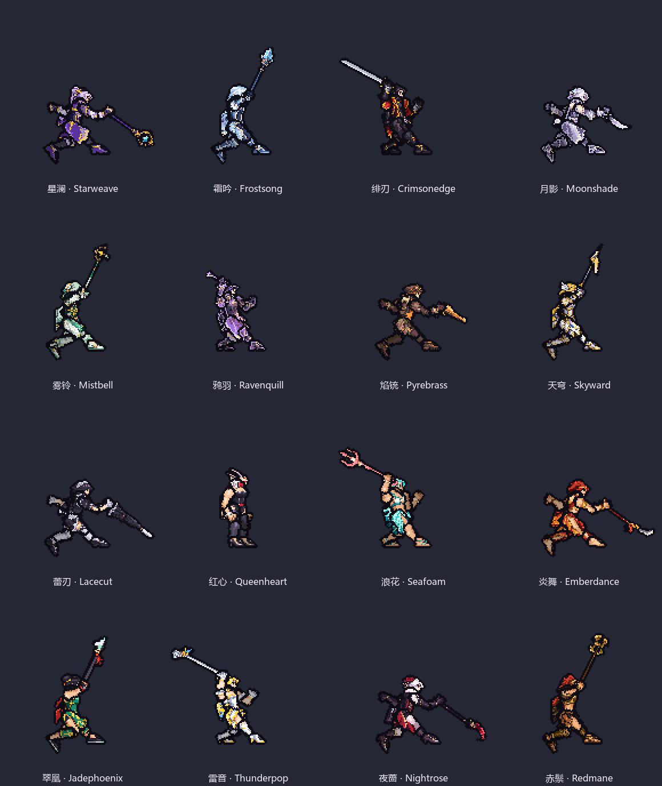

# 牌刃疾行 · 角色资产

[13 个角色站姿完整包](packages/deckblade-standing-A.zip) · [晨霜三视图与动作完整包](packages/deckblade-dawnfrost-BC.zip)

- `standing/`：13 张透明站姿 PNG，单帧 96×80，角色轮廓高 64 像素。
- `dawnfrost/`：三视图按朝右、正面、背面排列；六组动作均为单行图条，按 96×80 切帧。待机 4、跑步 8、斩击 6、施法 4、受击 2、跳跃 4，共 28 帧。
- 原生帧共用脚底基线 y=71；播放时长见晨霜目录的 manifest.json。跳跃位移由游戏控制。
- 两个 ZIP 保留生成原稿和八倍图。此提交仅添加资产，不改变游戏代码。

## 第二轮返工

按上游 17ef850 的提示词，重画铜炮、虚空、余烬、夜鸦，其余 9 张站姿不变。晨霜三视图现为 288×80，每格 96×80，脚底 y=71；三视角像素无损保留，六组动作未修改。

## 第三轮细化

依据上游 90fadde，保留第二轮的透明轮廓、朝向与脚底基线，仅细化四张站姿的内部像素。铜炮 14 色；虚空、余烬、夜鸦各 13 色。其余九张站姿、晨霜三视图及六组动作不变。

## 晨霜 · 战斗骨架分件

[原生 104×124 图集](parts/dawnfrost-parts.png) · [八倍 PNG](parts/dawnfrost-parts-8x.png) · [含骨架规格、姿势和组装器的 ZIP](packages/deckblade-dawnfrost-parts.zip) · [上游组装器的原始输出](previews/dawnfrost-skeleton.png)

8 个有效部件，披风格留空。按上游 5250bdf 的 parts.json 使用，原生与八倍图复现相同组装结果。下图使用上游 5 组 19 个姿势及扩展画布，仅作预览。

## 原创女性角色 · 站姿 A

根据上游 65fb25b 的 HEROINES 提示词制作：[8 张原生站姿](heroines/standing) · [角色清单](heroines/manifest.json) · [完整包：原生帧、八倍图和生成原稿](packages/deckblade-heroines-standing-A.zip)。画布 96×80，人物高 64 像素，脚底 y=71。本轮不含动作、分件或游戏解锁配置。

## 女性角色 · 九格战斗骨架分件

按上游 6d7dead 为八位角色各制作 9 件，原生 104×124、八倍 832×992。[独立角色图集](heroines/parts) · [完整包：图集、组装器、姿势、验收图](packages/deckblade-heroines-parts.zip) · [五组动作预览](previews/heroines-skeleton.gif)。八人共 152 个姿势已离线验证；不替换站姿，不改游戏代码。

## Glamour 系列 · 站姿第 1 轮

蕾刃、红心、浪花、炎舞、翠凰、雷音、夜蔷、赤鬃：已按上游 8098830 加入[固定站姿目录](heroines/standing)和[清单](heroines/manifest.json)。[女性角色完整站姿包（共 16 位）](packages/deckblade-heroines-standing-A.zip)含原稿、原生帧、八倍图。[全部站姿预览](previews/heroines-standing.png)。本轮未改动骨架分件。

## Glamour 站姿返工 1 与六套战斗分件

依据上游 66a21ae：赤鬃分材质配色，夜蔷整理裙褶、提亮面部并加清晰翼领。其余六位保留原站姿，现已添加九格战斗分件。六套原生/八倍图通过 114 个骨架姿势复验。[16 位站姿包](packages/deckblade-heroines-standing-A.zip) · [14 位分件包](packages/deckblade-heroines-parts.zip)。未修改游戏代码。

## Glamour 分件返工 2

根据上游 8ab9dee：只重画红心的头格，保留其余八格；以已确认站姿制作赤鬃与夜蔷的九格分件。站姿、其余十三位分件不变。[完整分件包（16 位）](packages/deckblade-heroines-parts.zip) · [原生部件](heroines/parts) · [骨架动作预览](previews/heroines-skeleton.gif)。
